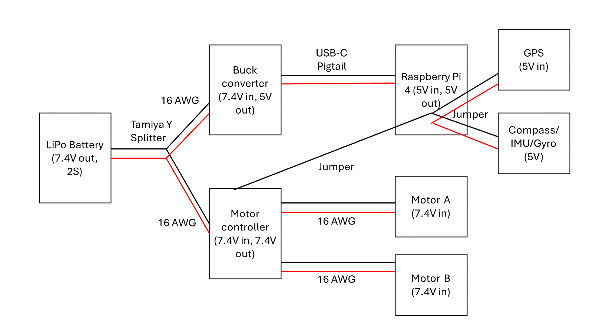

# Robotic Lawnmower

A Raspberry Pi 4 rover that drives itself over a GPS-bounded rectangle in a boustrophedon ("lawnmower") pattern. It fuses GPS, magnetometer and accelerometer readings with a Kalman filter and steers two DC motors toward each waypoint. This is the prototype platform; the long-term goal is a full-size mower.



## How it works

1. **Coverage planning** – [create_waypoint_list.py](create_waypoint_list.py) takes four corner coordinates, converts them to a local metre grid (flat-earth approximation, fine under ~1 km), and generates evenly spaced parallel passes. The result is written to [waypoints.py](waypoints.py).
2. **Sensing** – a NEO-6M GPS (UART, NMEA via `pynmea2`) gives position; an MPU-9250 gives magnetometer heading and acceleration over I²C.
3. **State estimation** – [navigate_path.py](navigate_path.py) runs a 4-state Kalman filter (`x, y, vx, vy`). The accelerometer, rotated into the East/North frame using the compass heading, drives the predict step, and GPS fixes drive the update step. GPS alone was too noisy to steer on, and the robot has no wheel encoders, so the filter bridges the gaps.
4. **Path following** – the position estimate is projected onto the current row so sideways GPS error does not cause needless steering. Heading error against the target bearing selects straight driving or a differential-speed turn.
5. **Actuation** – PWM on an L298N motor driver (BCM pins 18/17/27 for motor A, 13/5/6 for motor B).

## Hardware

| Function | Part |
| --- | --- |
| Computer | Raspberry Pi 4 |
| Power | 7.4 V 2S LiPo, MP1584EN buck converter to 5 V for the Pi |
| Motor driver | L298N |
| Drive | 2 DC gear motors, caster wheel, smart-robot chassis kit |
| GPS | GY-NEO6MV2 (u-blox NEO-6M) |
| Compass / IMU | MPU-9250 |
| Manual control | GameSir Nova Lite Bluetooth controller |

The wiring diagram source is [Wiring Diagram.pptx](Wiring%20Diagram.pptx); the parts list and project plan are in [Overview.docx](Overview.docx).

## Scripts

| Script | Purpose |
| --- | --- |
| [navigate_path.py](navigate_path.py) | Full autonomous run: waypoint generation, Kalman filter, path following |
| [navigate_to_target.py](navigate_to_target.py) | Drive to a single GPS coordinate (earlier milestone) |
| [create_waypoint_list.py](create_waypoint_list.py) | Generate lawnmower passes from four corners |
| [control_motors.py](control_motors.py) | Drive with a Bluetooth gamepad |
| [basic_motor_control.py](basic_motor_control.py) | Motor driver smoke test |
| [calibrate_magnetometer.py](calibrate_magnetometer.py) | Collect samples for hard-iron offsets (data in the `*calibration.txt` files and [Magnetometer Offsets.xlsx](Magnetometer%20Offsets.xlsx)) |
| [magnetometer_heading.py](magnetometer_heading.py) | Print compass heading |
| [read_gps.py](read_gps.py) | Print raw GPS fixes |
| [display_controller_input.py](display_controller_input.py), [find_controller_path.py](find_controller_path.py) | Gamepad discovery and debugging |

## Running it

On a Raspberry Pi with I²C and the serial port enabled:

```bash
pip install pyserial pynmea2 numpy RPi.GPIO mpu9250-jmdev
cp .env.example .env   # then set CORNER_A..CORNER_D to your field's corners ("lat,lon")
python navigate_path.py
```

Field coordinates live in `.env`, which is gitignored.

The run stops after `RUNTIME_LIMIT_S` seconds as a safety cutoff.

## Milestones

- [x] Drive with a remote controller
- [x] Drive to a single GPS coordinate
- [~] Cover a GPS-outlined sector (Kalman filtering and path projection in progress)
- [ ] Traverse a sector with obstacles
- [ ] Scale up the chassis
- [ ] Add cutting

## Lessons so far

- Consumer GPS wanders by several metres, so raw fixes make the robot hunt. A simple EMA helped but did not fix it; fusing the IMU in a Kalman filter did more.
- Without wheel encoders, speed is unknown on hills and rough ground. Accelerometer integration drifts, so GPS has to remain the long-term anchor.
- One mistyped digit in a corner longitude (`-86` for `-85`) made the planner generate about 175,000 waypoints for a field roughly 87 km wide. Validating field size before planning is on the to-do list.
