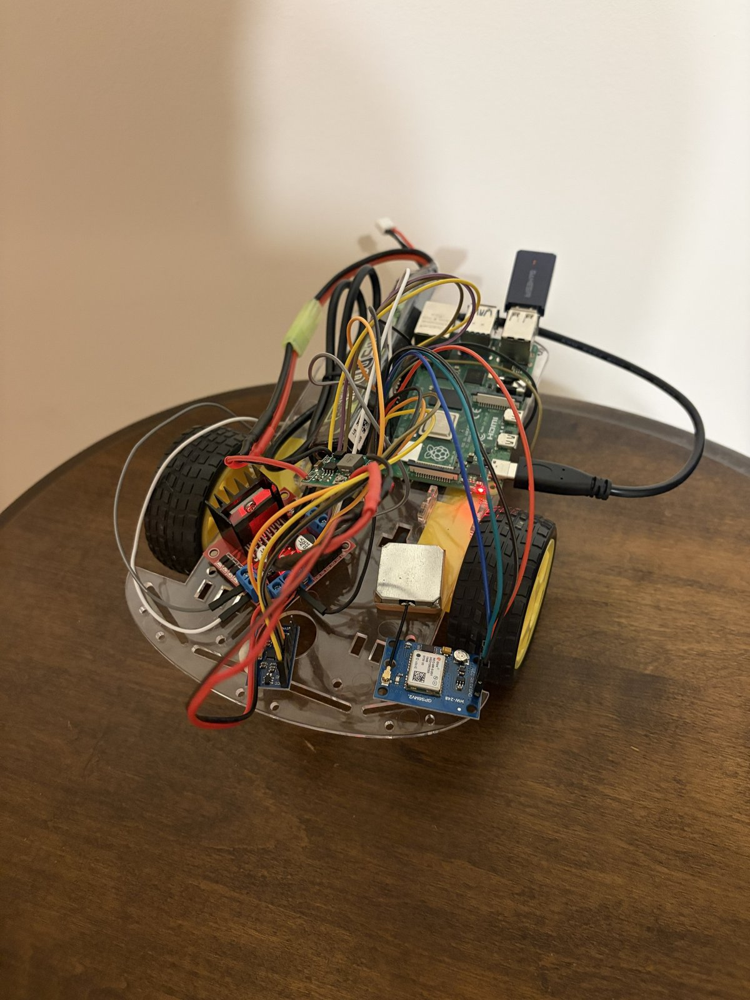
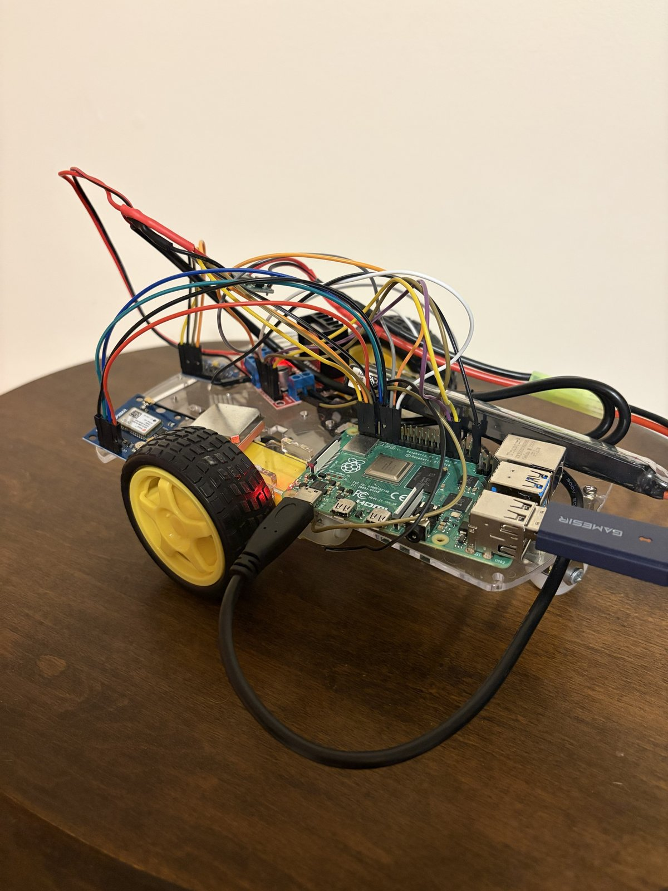
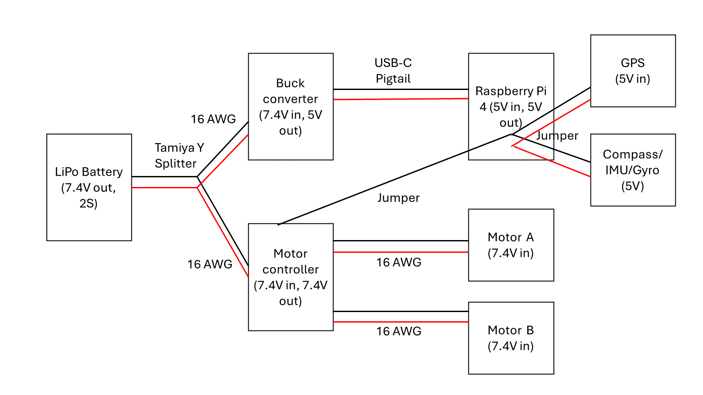
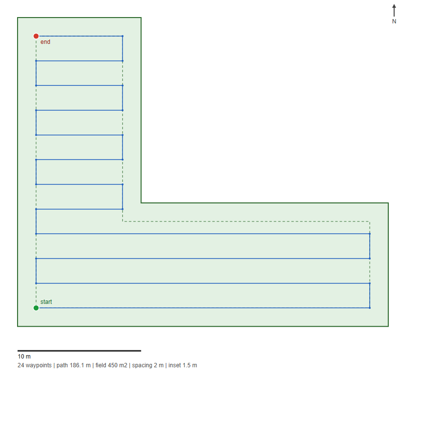

# Robotic Lawnmower

A Raspberry Pi 4 rover that drives itself over a GPS-bounded rectangle in a boustrophedon ("lawnmower") pattern. It fuses GPS, magnetometer and accelerometer readings with a Kalman filter and steers two DC motors toward each waypoint. This is the prototype platform; the long-term goal is a full-size mower.

<p>


</p>



## How it works

1. **Coverage planning** – [create_waypoint_list.py](create_waypoint_list.py) takes the field from `field.json` or `.env`, converts them to a local meter grid (flat-earth approximation, fine under ~1 km), and generates evenly spaced parallel passes. The boundary is checked first ([lawnmower/field.py](lawnmower/field.py)): a field wider than 500 m, corners on top of each other, a line instead of an area or a plan of more than 5,000 waypoints stops with a message instead of a plan. The result is written to [waypoints.py](waypoints.py).
2. **Sensing** – a NEO-6M GPS (UART, NMEA via `pynmea2`) gives position; an MPU-9250 gives magnetometer heading and acceleration over I²C.
3. **State estimation** – [navigate_path.py](navigate_path.py) runs a 4-state Kalman filter (`x, y, vx, vy`). The accelerometer, rotated into the East/North frame using the compass heading, drives the predict step, and GPS fixes drive the update step. GPS alone was too noisy to steer on, and the robot has no wheel encoders, so the filter bridges the gaps.
4. **Path following** – the position estimate is projected onto the current row so sideways GPS error does not cause needless steering. Heading error against the target bearing selects straight driving or a differential-speed turn.
5. **Actuation** – PWM on an L298N motor driver (BCM pins 18/17/27 for motor A, 13/5/6 for motor B).

## Hardware

| Function | Part |
| --- | --- |
| Computer | Raspberry Pi 4 |
| Power | 7.4 V 2S LiPo, MP1584EN buck converter to 5 V for the Pi |
| Motor driver | L298N |
| Drive | 2 DC gear motors, caster wheel, smart-robot chassis kit |
| GPS | GY-NEO6MV2 (u-blox NEO-6M) |
| Compass / IMU | MPU-9250 |
| Manual control | GameSir Nova Lite Bluetooth controller |

The wiring diagram source is [Wiring Diagram.pptx](Wiring%20Diagram.pptx); the parts list and project plan are in [Overview.docx](Overview.docx).

## Scripts

| Script | Purpose |
| --- | --- |
| [navigate_path.py](navigate_path.py) | Full autonomous run: waypoint generation, Kalman filter, path following |
| [navigate_to_target.py](navigate_to_target.py) | Drive to a single GPS coordinate (earlier milestone) |
| [create_waypoint_list.py](create_waypoint_list.py) | Generate lawnmower passes from the field and write `waypoints.py` |
| [sweep_plan.py](sweep_plan.py) | Compare planner settings by driving each in the simulator; no Pi needed |
| [replay_run.py](replay_run.py) | Summarize a run log copied off the Pi and replay it through the mission code; no Pi needed |
| [preview_plan.py](preview_plan.py) | Draw the plan on a computer (SVG and GeoJSON) before the robot moves; no Pi needed |
| [control_motors.py](control_motors.py) | Drive with a Bluetooth gamepad |
| [basic_motor_control.py](basic_motor_control.py) | Motor driver smoke test |
| [calibrate_magnetometer.py](calibrate_magnetometer.py) | Collect samples for hard-iron offsets (data in the `*calibration.txt` files and [Magnetometer Offsets.xlsx](Magnetometer%20Offsets.xlsx)) |
| [magnetometer_heading.py](magnetometer_heading.py) | Print compass heading |
| [read_gps.py](read_gps.py) | Print raw GPS fixes |
| [display_controller_input.py](display_controller_input.py), [find_controller_path.py](find_controller_path.py) | Gamepad discovery and debugging |

The navigation maths shared by the scripts lives in the [lawnmower/](lawnmower) package (`geometry.py`: bearing, distance, local frame and row projection; `steering.py`: compass heading and the turn decision; `kalman.py`: the GPS + accelerometer position filter; `mission.py`: the waypoint, projection and steering decisions for one loop step, which `navigate_path.py` calls after reading the sensors). It imports no Pi hardware libraries, so it runs and is tested anywhere.

## Running it

On a Raspberry Pi with I²C and the serial port enabled:

```bash
pip install pyserial pynmea2 numpy RPi.GPIO mpu9250-jmdev
cp field.example.json field.json   # then put your field's corners in "boundary" as [lat, lon]
python navigate_path.py
```

The field lives in `field.json`, which is gitignored (see [field.example.json](field.example.json): a `boundary` of four `[lat, lon]` points and an optional `pass_spacing_m`, default 1). Unknown settings are reported rather than ignored. `FIELD_FILE=other.json` picks a different file. Without a `field.json` the four corners are read from `.env` as before (`cp .env.example .env`, then set `CORNER_A`..`CORNER_D` as `lat,lon`); `field.json` wins when both exist. 

The boundary can have any number of points (in order around the field; four points may be in any order). Optional settings: `inset_m` keeps the passes that far inside the boundary and the same distance away from no-go zones (default 0, which puts the end of each pass on the edge; with roughly 3 m of GPS error you will probably want a metre or two, but that has not been tried on the rover), `heading_deg` sets the compass direction of the passes (0 = north, 90 = east; default: along the longest side, or the side direction that gives the fewest separate pieces), and `exclusions` lists no-go zones, each a ring of `[lat, lon]` points wholly inside the boundary (`"exclusions": [[[lat, lon], ...], ...]`). `cut_width_m` and `overlap_m` replace `pass_spacing_m` (the spacing is the cut width minus the overlap; set one or the other). `turn_depth_m` (default 0, never more than `inset_m`) sends the rover that far past the end of a pass before it turns onto the next, which gives a rover that turns in arcs room to come round: two extra waypoints at each turn, used only where they stay inside the real boundary and out of the zones, and the turn is left as it was where there is no room. The swing uses up some of the `inset_m` margin, and it should be more than the 0.5 m waypoint radius in `navigate_path.py`. A zone may not touch the boundary or another zone, margin included; the planner says which one if it does. A plain four-sided field with none of these settings is planned exactly as before; anything else goes through [lawnmower/coverage.py](lawnmower/coverage.py). It cuts the free space with parallel lines and drives them in alternating directions. Where a line meets a no-go zone or a notch it is split, and the pieces that continue each other form a cell mown in order with a connecting waypoint at each bend, so the rover never cuts across the outside of a corner. The cells are visited nearest-first, and between cells the rover follows the shortest route through the free space, around the zones and notches, never across them. Not tried on the rover yet, and a zone is only as safe as the margin you give it against GPS error.

The run stops after `runtime_limit_s` (180) seconds as a safety cutoff. It also stops, with the motors off, when [lawnmower/mission.py](lawnmower/mission.py) sees a failsafe trip: no GPS fix for 5 seconds (`no_fix_timeout_s`), the position filter's uncertainty above 10 m (`max_position_std_m`; about 3 m when the fixes are coming in, 10 m after roughly 5 seconds without one), or the position estimate more than 5 m outside the field boundary (`max_outside_m`; it needs the boundary, which `navigate_path.py` passes). Each can be set to `None` to switch it off. The limits come from the simulator (see [docs/SIMULATION.md](docs/SIMULATION.md)); they have not been tried on the rover.

### Record and replay a run

Every run of `navigate_path.py` writes `runs/run-<date>-<time>.jsonl` (gitignored): a header with the plan and settings, then one line per loop with the compass heading, accelerometer, GPS fix (or none), the filter's estimate and uncertainty, and the command sent to the motors. Copy it off the Pi and run:

```bash
python replay_run.py runs/run-20261104-101500.jsonl
```

It prints how long the run was, how many loops had no GPS fix, how uncertain the position got and how steady the loop rate was, then feeds the same readings back through [lawnmower/mission.py](lawnmower/mission.py) and lists any loop where today's code decides differently from what the rover did. If the log cannot be opened (full or read-only card) the run carries on without it.

### Simulated rover

[lawnmower/sim.py](lawnmower/sim.py) is a differential-drive rover and its sensors, so the mission code can be run against a field without the Pi. The motor commands become wheel speeds (`RoverParams`: top speed, track width, how fast a wheel comes up to speed); the sensors give what `Mission.step()` takes: a GPS fix once a second with fast noise plus a slowly wandering error, a compass heading with noise and an optional constant error, and a world-frame accelerometer with noise and a constant offset (`NoiseParams`). One seed makes a run repeatable.

```python
from lawnmower import sim
result = sim.simulate(waypoints, seed=1)   # result.finished, .waypoints_reached, .elapsed_s, .track
```

Every default is a guess until it is measured on the rover (the turning radius in [docs/FIELD_TRIALS.md](docs/FIELD_TRIALS.md) step 5, GPS and compass noise from a recorded run), so for now a simulation compares settings against each other; it does not promise what the rover will do. [sweep_plan.py](sweep_plan.py) uses it to compare settings:

```bash
python sweep_plan.py --field field.json --inset 0,1,2 --turn-depth 0,1 --gps-error 1,2.5 --turn-speed 80,60,0 --seeds 8 --jobs 4 --csv sweep.csv --svg best.svg
```

It plans the field once for every combination (`--inset`, `--turn-depth`, `--stop-distance` for the waypoint radius, `--gps-error` for the total GPS error in metres, `--turn-speed` for the inner wheel), drives each plan in the simulator with `--seeds` different noise draws, and prints a row per combination: the share of the mowable grass a cut-width strip along the real track passed over, the farthest the rover got outside the boundary and into a no-go zone, the time, whether every run finished, and whether the row meets `--coverage-target` (95) and `--max-excursion` (1 m). `--svg` draws the recommended row's route in orange over its plan. [docs/SIMULATION.md](docs/SIMULATION.md) has what it says about a 30 m by 20 m sample lawn (`docs/examples/lawn-30x20.json`).

### Preview a plan before the rover moves

```bash
python preview_plan.py                       # reads field.json (or .env), writes plan.svg and plan.geojson here
python preview_plan.py --field other.json --out previews
```

`plan.svg` opens in any browser: the field boundary, the boundary moved inwards by `inset_m` (dashed), the no-go zones (red, with their margin dashed), the path through every waypoint, the start (green) and end (red), a north arrow and a scale bar, with the waypoint count, path length and field area underneath. `plan.geojson` has the same layers in longitude/latitude order for geojson.io, QGIS or any map tool. Both are gitignored because the GeoJSON holds your field's coordinates. This needs no Pi and no extra packages.



Before putting any of this on the rover, follow [docs/FIELD_TRIALS.md](docs/FIELD_TRIALS.md): an ordered list from "nothing moves" to "mows around a no-go zone", including how to measure the rover's turning radius. None of the planner changes since the polygon work has run on the Pi yet.

### Tests

```bash
python -m unittest discover -s tests
```

The tests need no Pi, only `numpy`. They cover the waypoint planner (coordinate conversion, corner ordering, pass count, spacing, coverage and direction for wide and tall fields), the `field.json` and `.env` loading (including a golden check that the example field plans the same waypoints as before), the polygon planner and the preview output, and the `lawnmower/` navigation maths (bearing wraparound, heading error at ±180°, distance, row projection and clamping, compass heading, steering decision), the mission logic with scripted sensor input (waiting for a fix, steering, waypoint advance, row projection, finishing, time limit), the run log (a recorded run replays to the same decisions; a changed setting shows where it differs), the simulator (straight lines, the turning radius of a fixed wheel-speed pair, spinning on the spot, the statistics of each sensor's noise, repeatability from a seed, and the mission driving a leg to its end), the failsafes (stopping after a GPS dropout, an uncertain position and a drift off the field, and never stopping healthy runs), the scoring of a driven track (coverage of the mowable area, distance outside the boundary and into zones) and the sweep tool, and the Kalman filter (convergence on a fixed target, noise smoothing, dead-reckoning kinematics, uncertainty growth and shrinkage). The sensor reading and motor code still only run on the robot and are not tested; GitHub Actions just checks that every script still compiles, then runs these tests. Dependabot opens weekly pull requests to update the pinned GitHub Actions versions.

## Milestones

- [x] Drive with a remote controller
- [x] Drive to a single GPS coordinate
- [~] Cover a GPS-outlined sector (Kalman filtering and path projection in progress)
- [ ] Traverse a sector with obstacles
- [ ] Scale up the chassis
- [ ] Add cutting

## Lessons so far

- Consumer GPS wanders by several meters, so raw fixes make the robot hunt. A simple EMA helped but did not fix it; fusing the IMU in a Kalman filter did more.
- Without wheel encoders, speed is unknown on hills and rough ground. Accelerometer integration drifts, so GPS has to remain the long-term anchor.
- One mistyped digit in a corner longitude (`-86` for `-85`) made the planner generate about 175,000 waypoints for a field roughly 87 km wide. The planner now refuses a field like that (and other impossible shapes) with a message that says what to check; the field limits are in [lawnmower/field.py](lawnmower/field.py).

## License

MIT. See [LICENSE](LICENSE).
